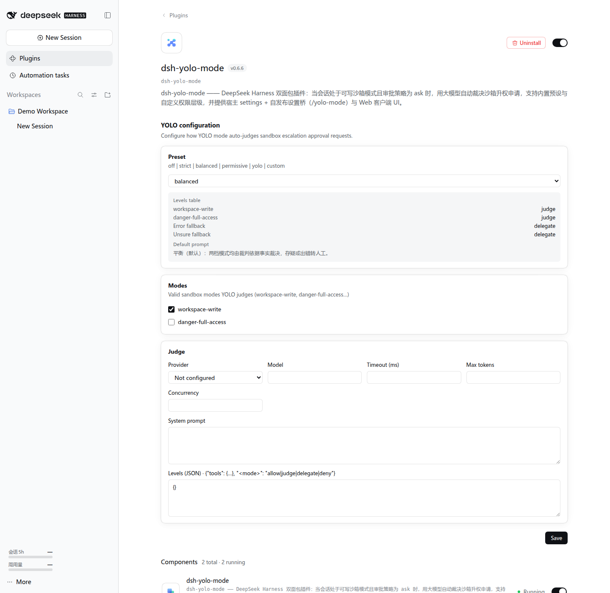
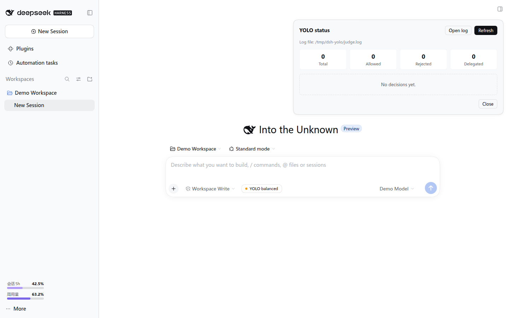

<div align="center">

# ⚡ dsh-yolo-mode

**A DeepSeek Harness plugin that uses an LLM to auto-adjudicate sandbox escalation requests**

[](https://www.npmjs.com/package/dsh-yolo-mode)
[](https://www.npmjs.com/package/dsh-yolo-mode)
[](LICENSE)
[](package.json)
[](https://github.com/SeverusZh/dsh-yolo-mode/releases)
[](https://github.com/SeverusZh/dsh-yolo-mode)
[](https://github.com/deepseek-ai/deepseek-harness)
[](https://awesome-dsh-plugin.com)

</div>

> **Maintenance status**: DSH now ships an experimental Auto review capability (`@deepseek-ai/dsh-experimental-auto-review` — per-tool LLM authorization review that replaces manual approval under the `ask` approval policy), which overlaps with this plugin's "LLM-judge auto-approval". As a result this plugin **may stop being maintained in the future**; if you want the official native auto-approval, evaluate that experimental feature. The current version still tracks DSH compatibility (most recently tested on **0.2.1-rc.2**).

When a session is in a writable sandbox mode and the approval policy is `ask`, `dsh-yolo-mode` intercepts `escalate sandbox to ...` requests and, according to the **preset** you choose or a **custom permission hierarchy**, has an LLM adjudicate "allow / deny / delegate". Any uncertain or failed path never allows escalation (**fail-closed**).

---

## ✨ 功能特性 / Features

- **LLM auto-adjudication**: in a `workspace-write` session, `danger-full-access` / `workspace-write` escalation requests are graded by an LLM (`allow / deny / unsure`), removing the manual prompt when the verdict is confident.
- **Built-in presets**: `off` / `strict` / `balanced` (default) / `permissive` / `yolo` / `custom`, spanning the full range from "delegate everything to a human" to "deterministically allow everything".
- **Custom hierarchy**: `levels` supports per-target-mode and per-tool (`tools.<toolName>`) `allow / judge / delegate / deny` policies, plus `error` / `unsure` fallbacks.
- **Per-preset default prompts**: when `judge.systemPrompt` is empty, the judge prompt for the preset is used automatically (strict is the most conservative, permissive is lenient, custom follows the hierarchy table).
- **Graphical configuration**: the plugin detail page lets you edit the preset / effective modes / judge model (dropdown) / hierarchy table online, effective on save; plus an input-bar status chip and a decision-statistics panel.
- **Full audit trail**: every verdict is written to a JSONL log with tool, target mode, current mode, reason, decision and outcome; the status dialog has a one-click "Open log" that opens it in the system default application.
- **fail-closed**: timeouts, invalid output, model unavailability, concurrency overflow and every other exceptional path fall back to "deny" or "delegate".

## 📦 安装 / Install

### 1. Install the plugin package

```bash
# From npm
dsh plugin --profile web add dsh-yolo-mode

# Or from a local path
dsh plugin --profile web add <absolute path to project>
```

### 2. Optional: Override the plugin configuration

`dsh plugin add` automatically mounts both the `yolo-mode` and `yolo-mode-bridge`
entries via the `cordis.patch.yml` shipped with the package — you do **not** need to
`insert` them manually. To adjust the configuration, override the main entry by id in
`$DSH_HOME/profiles/web/cordis.patch.yml`:

```yaml
- id: yolo-mode
  name: dsh-yolo-mode
  config:
    preset: balanced
    judge:
      provider: <provider>
      model: <model>
```

> Note: do not add `yolo-mode` / `yolo-mode-bridge` with `- insert:` again, or startup
> will fail with `duplicate loader entry id: yolo-mode`.

Restart DSH and refresh the browser for the changes to take effect.

### Installation notes

- Prefer `dsh plugin --profile web add dsh-yolo-mode` directly (the npm release already
  includes the build output; peer dependencies are provided by DSH's
  `$DSH_HOME/profiles/node_modules` fallback, so it works out of the box).
- When developing with a local `link:`, the checkout must live under
  `$DSH_HOME/profiles/` (or the repo must carry its own node_modules); otherwise the
  `@deepseek-ai/*` peer dependencies fail with `ERR_MODULE_NOT_FOUND` because Node
  resolves them along the real path.

## ⚙️ 配置 / Configuration

All fields of the plugin line's `config` are optional; unset fields use their defaults:

| Field | Type | Default | Description |
|---|---|---|---|
| `preset` | `off\|strict\|balanced\|permissive\|yolo\|custom` | `balanced` | Preset to use; when `custom`, `levels` takes precedence |
| `modes` | `string[]` | `['workspace-write']` | Only intervene when the session's effective sandbox mode ∈ this list (`read-only` / `workspace-write` / `danger-full-access`) |
| `levels` | `object` | `{}` | Permission hierarchy table; `levels.tools.<toolName>` overrides per tool for any preset |
| `judge.provider` | `string` | `''` | Judge model provider; empty = not configured (judge decisions fall back as errors) |
| `judge.model` | `string` | `''` | Judge model; the judge is enabled only when both provider and model are non-empty |
| `judge.systemPrompt` | `string` | `''` | Judge system prompt; empty = use the preset default |
| `judge.timeoutMs` | `number` | `20000` | Per-judge timeout (ms) |
| `judge.maxTokens` | `number` | `4096` | Max output tokens for the judge (reasoning models need a larger value, see below) |
| `judge.concurrency` | `number` | `2` | Max concurrent judges; overflow falls back as an error |
| `includeSubagents` | `boolean` | `true` | Whether subagent sessions are adjudicated too |
| `auditFile` | `string` | `''` | Audit log path; empty = `%TEMP%/dsh-yolo/judge.log` |

> ⚠️ **Reasoning models must raise `judge.maxTokens`**: if the judge model emits an internal reasoning / chain-of-thought block before the final JSON verdict, the token budget is consumed by that reasoning; when the budget is too small, `content` is empty with `finish_reason=length`, the judge fails with `BAD_OUTPUT` and falls back to "delegate" (under the default `balanced` preset this shows up as **a manual approval prompt every time**). The default was raised from `256` to **`4096`**; if you still hit fallbacks, raise it further (e.g. `8192`). Such failures carry `error: "BAD_OUTPUT"` in the audit log.

### Permission hierarchy levels

```yaml
levels:
  workspace-write: judge        # target mode -> policy
  danger-full-access: judge
  error: delegate               # judge-error fallback
  unsure: delegate              # judge-unsure fallback
  tools:
    pwsh: delegate              # per-tool override, highest priority
    write: allow
```

Policy values are `allow | judge | delegate | deny`; priority: `levels.tools[toolName]` → base row (for `custom`, `levels[targetMode]`; other presets use a built-in table).

## 🎯 预设 / Presets

| Preset | `workspace-write` | `danger-full-access` | Error fallback | Unsure fallback | Description |
|---|---|---|---|---|---|
| `off` | delegate | delegate | delegate | delegate | Do not intervene; delegate everything to a human |
| `strict` | judge | delegate | rejected | delegate | Adjudicate `workspace-write` only; `danger-full-access` always delegates |
| `balanced` (default) | judge | judge | delegate | delegate | Adjudicate all escalation targets; error / unsure delegates |
| `permissive` | judge | judge | delegate | **allowed-once** | Adjudicate all targets; unsure counts as allow (use with care) |
| `yolo` | allow | allow | — | — | Deterministically allow everything, zero LLM calls |
| `custom` | per `levels` | per `levels` | per `levels.error` | per `levels.unsure` | All fields open |

Default judge prompt per preset (used automatically when `judge.systemPrompt` is empty):

| Preset | Default judge stance |
|---|---|
| `off` / `yolo` | No judge invoked |
| `strict` | Most conservative: `danger-full-access` always denied; only a minimal-scope `workspace-write` with a very strong justification is allowed |
| `balanced` | General audit: facts only, loop prevention, deny/unsure when in doubt |
| `permissive` | Lenient: leans to allow when the justification is reasonable and the scope is acceptable; denies only clearly destructive / supply-chain risks |
| `custom` | Adjudicate per the `levels` hierarchy table, falling back to `levels.error` / `levels.unsure` when in doubt |

## 🖥️ 界面 / UI

- **Input-bar chip**: shows `YOLO <preset>`; clicking it opens a statistics panel (total approvals / allowed / denied / delegated + a recent-decisions table, 5 per page, with previous / next page navigation).
- **Open log**: the "Open log" button in the top-right of the dialog opens the audit JSONL (the `auditFile` config or the default `%TEMP%/dsh-yolo/judge.log`) in the system default application; if the file does not exist yet it reports that there are no records.
- **Configuration page**: the plugin detail page lets you edit the preset, effective sandbox modes, judge model (provider / model dropdowns, taken from the Harness model configuration) and hierarchy table (JSON) online; switching the preset auto-fills that preset's default prompt and hierarchy table, and saving takes effect immediately with success / failure feedback.

## 🖼️ 界面预览 / Screenshots

The screenshots below come from a throwaway local preview instance; the example data is for demonstration only:





## 🔒 安全 / Security

- **fail-closed**: only an explicit `allow` returns a one-shot `allowed-once`; every other path denies or delegates.
- **Loop prevention**: the judge prompt is isolated from the agent context, preventing a model from using the Web approval flow to loop back and self-approve `danger-full-access`.
- **No policy rewriting**: acts only as a responder under the `ask` policy and does not change DSH's sandbox / approval vocabulary.
- **Conservative by default**: the default preset is `balanced` (unsure → delegate); `permissive` / `yolo` are not enabled by default.
- **Audit**: each verdict writes one JSONL line containing `{time, sessionId, origin, toolName, callId?, targetMode, currentMode, justification, decision, outcome, reason?, error?}`. `error` appears only on a **judge failure** (its value is a `JudgeError` code such as `BAD_OUTPUT` / `TIMEOUT` / `STREAM_ERROR` / `NO_ADAPTER`); `outcome:"delegate"` with `error` = judge failure delegated to a human, without `error` = judge actively delegated — the two are distinguishable.
- **Failures are visible**: the statusView payload carries `judgeErrors: { count, lastError?, lastErrorTime? }` (cumulative judge-failure count and the most recent error code), so judge anomalies no longer stay buried in `logger.warn` only.

## 🧩 兼容性 / Compatibility

Since DSH 0.2.1 the compatibility gate prefers `engines.dsh`. This plugin declares **`engines.dsh: ">=0.1.7-rc.1"`** (no upper bound), keeps the dsh peers at `>=0.1.7-rc.1`, and has been checked on:

| DSH version | Status |
| --- | --- |
| 0.1.5-rc.1 | ✅ Tested |
| 0.1.5-rc.2 | ✅ Tested |
| 0.1.6-alpha.2 | ✅ Tested |
| 0.1.7-rc.1 | ✅ Tested |
| 0.1.7-rc.2 | ✅ Tested |
| 0.2.0-rc.1 | ✅ Tested |
| 0.2.1-rc.1 | ✅ Gate + 141 tests + build |
| 0.2.1-rc.2 | ✅ Gate |

> Only versions that were **actually run** are listed; untested versions are omitted.

v0.6.6 supports DSH **0.1.5-rc.1+** (the `@deepseek-ai/dsh-*` peer was relaxed to `>=0.1.7-rc.1`); all of the versions above passed a real-Cordis probe: the settings subsystem was migrated to 0.1.7's `SettingsForms` (plugin Config schema + volatile hot-reload + a self-built settings page); on 0.1.7-rc.2 the provider/model directory is read via the client's `remote.llm` + `remote.session`; on 0.2.0-rc.1 it passes the new compatibility gate and loads normally; 0.2.1-rc.1 passes the gate, 141 tests and the client build, and 0.2.1-rc.2 passes the gate. The 0.2.1 `remote.llm` / `remote.session` directory APIs remain present. For older DSH (0.1.0-rc.6 / rc.8), use the last compatible npm version, **0.4.1**.

## 🛠️ 开发 / Develop

```bash
npm test        # node --test full test suite
npm run build   # build the client bundle (rolldown)
```

## 📄 许可证 / License

[MIT](LICENSE)
